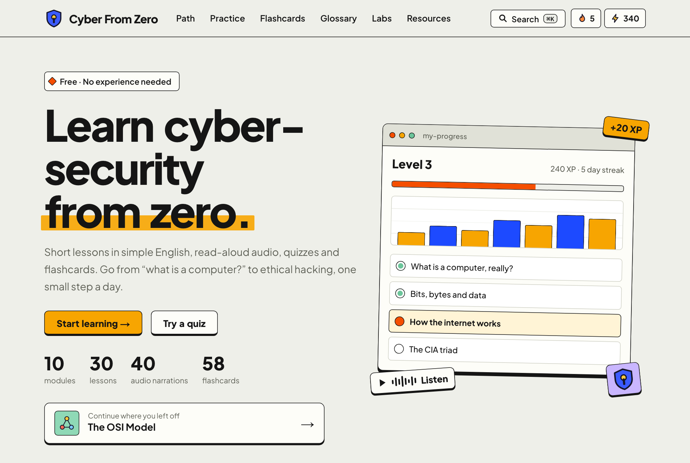
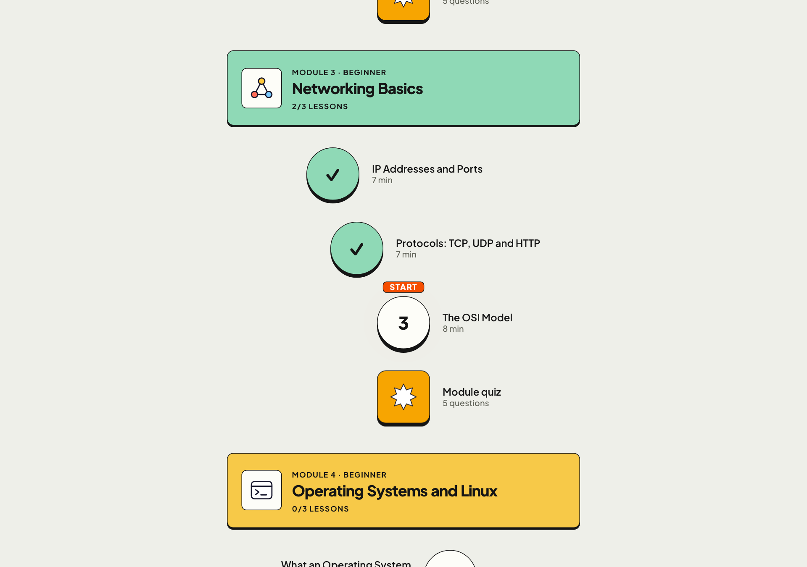
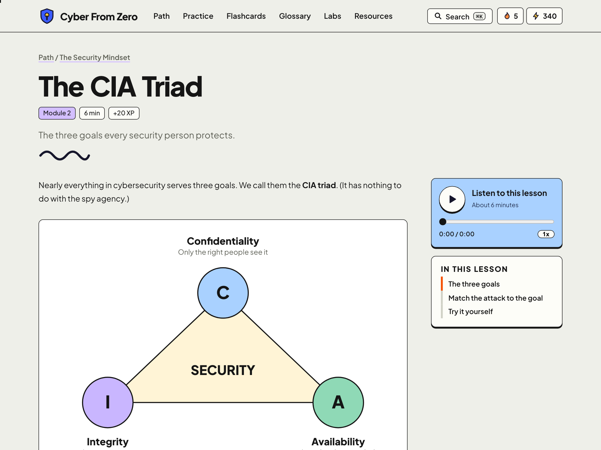
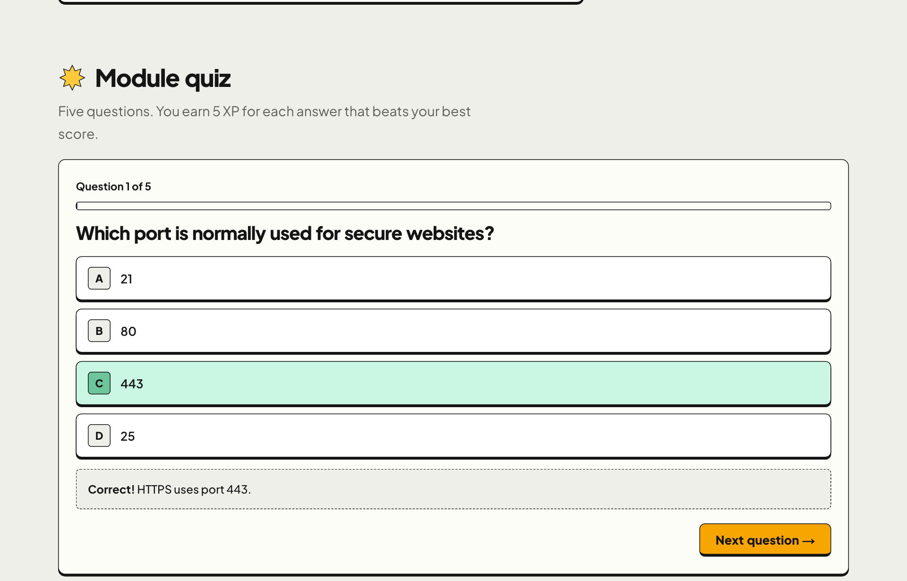
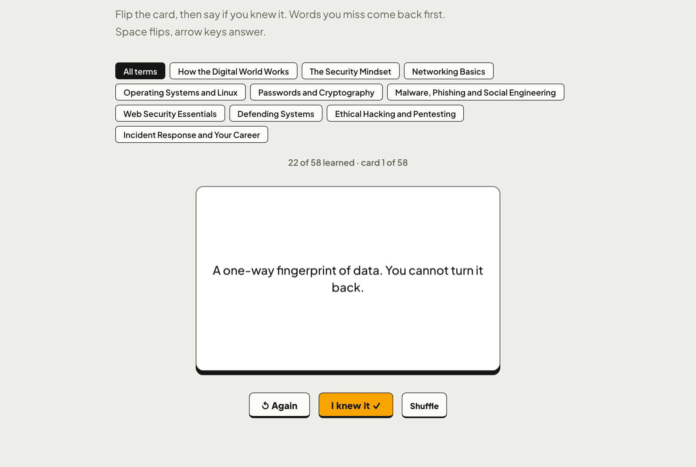
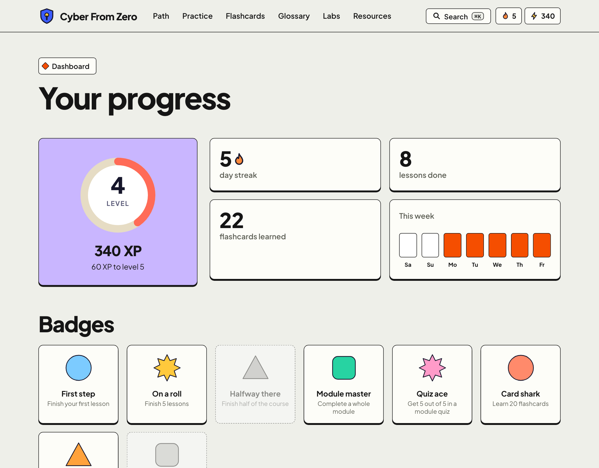
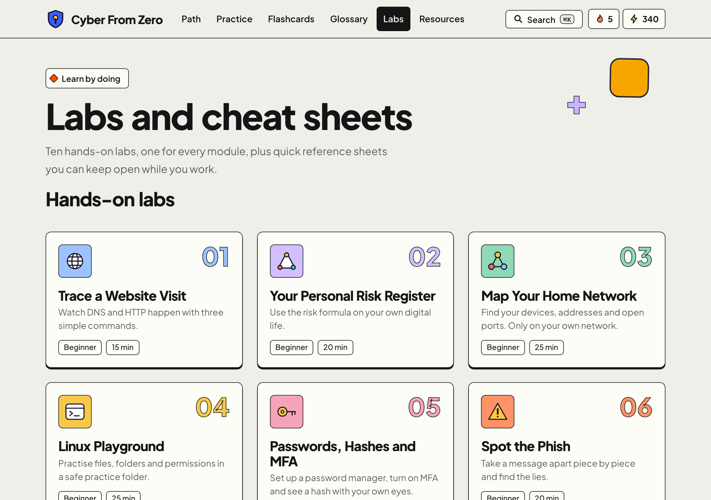
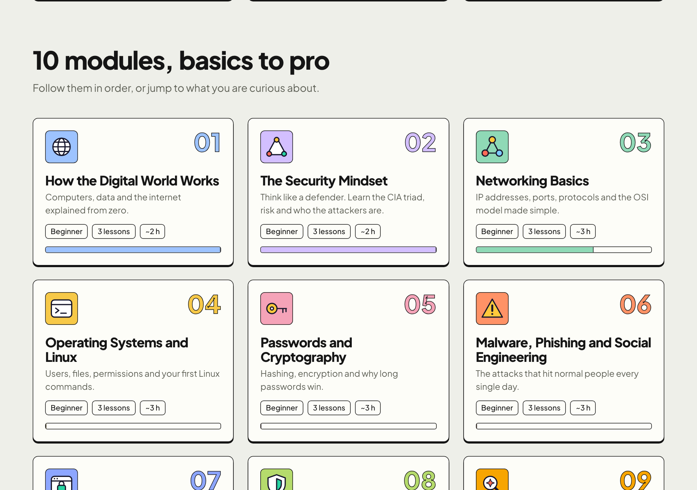
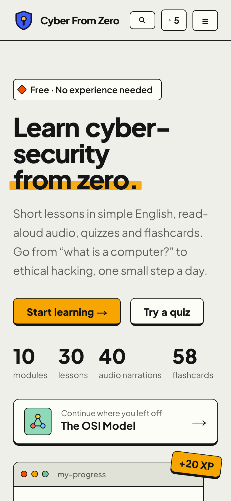
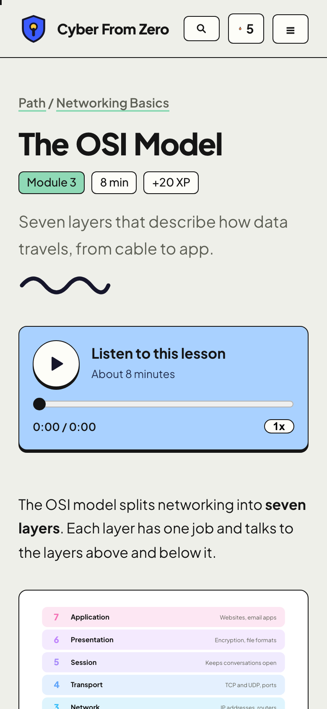

<div align="center">

# Cyber From Zero

**A free cybersecurity course in simple English, from "what is a computer?" to ethical hacking.**

Short lessons · narrated audio · quizzes · flashcards · hands-on labs · a learning path with XP and streaks




</div>

---

## Why this exists

Most cybersecurity material assumes you already know networking, Linux and a pile of jargon. This course assumes nothing. It is written so that **an 18 year old with no experience** can follow it: short sentences, everyday comparisons (post offices, apartment buildings, house locks) and a plain-English explanation for every new word.

It is built to be **learned from**, not just read:

- Every lesson has **narrated audio** you can play like a podcast.
- Every module ends with a **quiz**, and key words become **flashcards**.
- Every module has a **hands-on lab** you can run safely on your own computer.
- A **learning path**, XP, streaks and badges make it easy to come back every day.

## Screenshots

<table>
  <tr>
    <td width="50%"><br><sub><b>Learning path.</b> A trail through every lesson. The next one is marked START.</sub></td>
    <td width="50%"><br><sub><b>Lessons.</b> Audio player, contents list, diagrams, tables and a takeaway card.</sub></td>
  </tr>
  <tr>
    <td width="50%"><br><sub><b>Quizzes.</b> One question at a time with an instant explanation.</sub></td>
    <td width="50%"><br><sub><b>Flashcards.</b> 58 plain-English terms. Words you miss come back first.</sub></td>
  </tr>
  <tr>
    <td width="50%"><br><sub><b>Dashboard.</b> Level, streak, weekly activity and badges.</sub></td>
    <td width="50%"><br><sub><b>Labs and cheat sheets.</b> Ten hands-on labs and six quick references.</sub></td>
  </tr>
  <tr>
    <td colspan="2"><br><sub><b>Ten modules</b>, each with its own icon and colour.</sub></td>
  </tr>
</table>

<p align="center">
  
  &nbsp;&nbsp;&nbsp;
  
  <br><sub>It works on phones too.</sub>
</p>

> The screenshots show demo progress. A fresh visit starts at zero. You can regenerate them with `npm run screenshots` (see below).

## What is inside

| #   | Module                                   | Level        | Lessons                                                        |
| --- | ---------------------------------------- | ------------ | -------------------------------------------------------------- |
| 1   | How the Digital World Works              | Beginner     | What is a computer, bits and data, how the internet works      |
| 2   | The Security Mindset                     | Beginner     | The CIA triad, threats and risk, who the attackers are         |
| 3   | Networking Basics                        | Beginner     | IP addresses and ports, TCP/UDP/HTTP, the OSI model            |
| 4   | Operating Systems and Linux              | Beginner     | What an OS does, Linux commands, file permissions              |
| 5   | Passwords and Cryptography               | Beginner     | Strong passwords, hashing vs encryption, your first cipher     |
| 6   | Malware, Phishing and Social Engineering | Beginner     | Malware, spotting phishing, social engineering                 |
| 7   | Web Security Essentials                  | Intermediate | Requests and cookies, OWASP Top 10, SQL injection and XSS      |
| 8   | Defending Systems                        | Intermediate | Firewalls and VPNs, defence in depth, hardening and monitoring |
| 9   | Ethical Hacking and Pentesting           | Intermediate | The attack phases, tools, practising legally                   |
| 10  | Incident Response and Your Career        | Advanced     | Incident response, law and ethics, career path                 |

Plus **10 labs** (one per module), **6 cheat sheets**, **50 quiz questions**, **58 glossary terms** and **40 audio narrations**. A 10 week [study plan](docs/STUDY-PLAN.md) is included.

## Features

- **Learning path** with a START marker, plus module and lesson pages
- **Narrated audio** for every lesson and module overview, with seek and speed control
- **Practice mode**: a mixed 10-question challenge or one module at a time, with explanations
- **Flashcards** that bring back the words you miss, and a searchable **glossary**
- **XP, levels, day streaks and 8 badges**, saved in your browser only (no accounts, no tracking)
- **Interactive widgets**: a Caesar cipher playground and a password strength meter
- **SVG diagrams** drawn in code: CIA triad, OSI layers, HTTP flow, password cracking time and more
- **Search** anywhere with <kbd>Ctrl</kbd>/<kbd>⌘</kbd> + <kbd>K</kbd>
- Reading progress bar, lesson contents list, takeaway cards and keyboard-friendly quizzes and flashcards
- Fully **static**: every page is pre-rendered, so it is fast and easy to host

## Quick start

You need **Node.js 20.9 or newer**.

```bash
git clone <your-fork-or-this-repo-url>
cd cyber-from-zero
npm install
npm run dev
```

Open <http://localhost:3000>.

### Scripts

| Command                 | What it does                                                               |
| ----------------------- | -------------------------------------------------------------------------- |
| `npm run dev`           | Start the dev server with hot reload                                       |
| `npm run build`         | Make the production build (also type-checks)                               |
| `npm start`             | Serve the production build                                                 |
| `npm run format`        | Format all files with Prettier                                             |
| `npm run format:check`  | Check formatting without changing files (CI runs this)                     |
| `npm run typecheck`     | Run TypeScript without building                                            |
| `npm run check:content` | Check quizzes, lesson front matter, labs and glossary for mistakes         |
| `npm run audio`         | Record narration for lessons and modules that have none (see below)        |
| `npm run screenshots`   | Retake the README screenshots (needs `npm run build && npm start` running) |

### Narrated audio

Audio is recorded with Microsoft's free neural voices through [`edge-tts`](https://github.com/rany2/edge-tts). Only the public course text is sent to the speech service.

```bash
pip install edge-tts
npm run audio                                # record files that are missing
FORCE=1 npm run audio                        # re-record everything
ONLY=the-osi-model FORCE=1 npm run audio     # re-record matching files only
VOICE=en-US-AndrewNeural npm run audio       # try another voice
```

The default voice is `en-US-AvaNeural`. Files are written to `public/audio/`. The script reads the TypeScript content loader directly, so it needs **Node.js 22.18 or newer**.

## Project structure

```
cyber-from-zero/
├── content/                 The course itself, in plain Markdown
│   ├── modules/NN-slug/     index.md, NN-lesson.md files and quiz.json
│   ├── labs/                Hands-on labs
│   └── cheatsheets/         Quick references
├── docs/                    Study plan, content style guide, screenshots
├── public/audio/            Narration files (modules/ and lessons/)
├── scripts/                 make-audio.mjs and screenshots.mjs
├── src/
│   ├── app/                 Next.js App Router pages
│   ├── components/          UI, charts/ (SVG diagrams) and widgets/ (interactive)
│   ├── data/                glossary.ts and resources.ts
│   └── lib/                 Content loader, progress store (XP, streaks)
├── .github/                 Issue forms, pull request template and CI
├── .prettierrc.json         Shared code style (Prettier)
└── .editorconfig            Basic editor settings
```

The site reads everything in `content/` at build time, so **adding a lesson means adding a Markdown file**. No code needed. See [CONTRIBUTING.md](CONTRIBUTING.md) for the format.

## Tech stack

- [Next.js 16](https://nextjs.org) (App Router, static generation) and React 19
- TypeScript, plain CSS with design tokens (no CSS framework)
- `react-markdown` and `remark-gfm` for lessons
- Hand-written SVG for every diagram, icon and shape
- Fonts through `next/font`: Plus Jakarta Sans and Source Code Pro
- [Prettier](https://prettier.io) keeps everyone's code and Markdown in one style
- No database, no accounts, no analytics. Progress lives in `localStorage`.

## Contributing

**Contributions are very welcome**, and you do not need to be a developer. You can:

- fix a typo or a confusing sentence
- suggest or write a new lesson, lab, quiz question or glossary term
- improve a diagram, the design or accessibility
- fix a bug or add a feature

Start with [CONTRIBUTING.md](CONTRIBUTING.md). Look for issues labelled `good first issue`, or open one using the [issue forms](.github/ISSUE_TEMPLATE). Please read the [Code of Conduct](CODE_OF_CONDUCT.md) first. If you find a security problem, see [SECURITY.md](SECURITY.md).

## Ground rules

This course teaches **defence and ethical hacking**. Only test systems you own or have written permission to test. Contributions that help people attack real targets will not be accepted.

## License

- **Code** (`src/`, `scripts/`, config files): [MIT](LICENSE)
- **Course content** (`content/`, `docs/`, quiz and glossary text): [CC BY 4.0](CONTENT-LICENSE.md). Share and adapt it, with credit.

Audio files are generated from the course text. Third-party names and links (TryHackMe, Hack The Box, PortSwigger and others) belong to their owners and are included only as learning resources.
